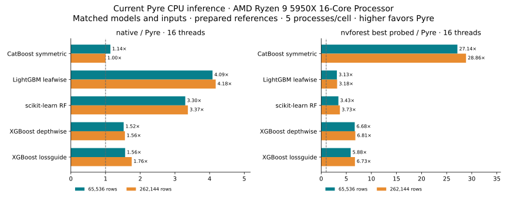

# Pyre


[](https://github.com/idlab-discover/pyre/actions/workflows/ci.yml)
[](https://github.com/idlab-discover/pyre/releases)

**CPU and GPU tree-ensemble inference in pure Mojo.** Pyre evaluates
[Balsa](https://github.com/idlab-discover/balsa) models with
[NuMojo](https://github.com/Mojo-Numerics-and-Algorithms-group/NuMojo) arrays,
without Python or libtreelite in the inference runtime.

- Float32 and float64 regression and binary classification, with missing-value routing.
- Automatic CPU dispatch for constant, symmetric, and general tree structures.
- Resident GPU inference, explicit transfers, and reusable output buffers.

## Get started

Requires Linux x86-64, [Pixi](https://pixi.sh), Git, and a C linker such as GCC.
The locked environment provides Mojo **1.2.0**, MAX core **26.7.0**, and NuMojo
**0.12.0**. Preparation fetches the pinned Balsa 0.2.1 revision automatically.

```sh
git clone https://github.com/idlab-discover/pyre.git
cd pyre
git checkout v0.2.0
pixi install --locked
pixi run run
```

```mojo
from balsa import load_editable
from pyre import Forest
from numojo import NDArray
from numojo.core.type_aliases import Shape


def main() raises:
    var forest = Forest(load_editable("build/balsa-reference/tests/fixtures/float32_op2_missing0.tl"))
    var x = NDArray[DType.float32](Shape(3, 1))
    x.itemset(0, 0.0)
    x.itemset(1, 0.5)
    x.itemset(2, 1.0)
    print(forest.predict(x))  # [-1, 3, 3]
```

Save as `app.mojo` in the repository root and run
`pixi run mojo run -I src -I build/balsa-reference/src app.mojo`.
For use from another project, see [packaging and release](docs/distribution.md):
the Conda package is `mojo-pyre`, imported as `pyre`.

## API and defaults

| Operation | Result |
| --- | --- |
| `forest.predict(x)` | Regression values |
| `forest.predict_margin(x)` | Raw margins |
| `forest.predict_proba(x)` | Binary probabilities, `[rows, 2]` |
| `forest.predict_class(x)` | Int64 labels, threshold 0.5 |

Inputs are contiguous `[rows, features]` arrays matching the model's precision.
`Forest(model^)` consumes the model into packed storage; `Forest(model.copy())`
retains your original.
Construction validates the model and prepares its execution strategy once.
Categorical splits, vector leaves, and multiclass/multi-target output are not supported.

CPU calls use `num_threads=0` for work-based automatic scheduling up to the
physical core count; an explicit positive value sets a per-call task limit.
Only constant forests always run serially. `GpuForest` uses explicit device
storage and completes calls before returning; `*_into` methods reuse output
allocations, which roughly halves small-batch GPU latency. GPU launch plans
derive from the device's discovered limits, and `tune(batch)` measures the
best plan on your data; host-array calls overlap uploads with compute. GPU
execution has been validated on an RTX 5090; other GPU targets remain
unvalidated.
See the [user guide](docs/usage.md) and [GPU example](examples/predict_gpu.mojo).

## Performance snapshot

### Current CPU measurements

Ryzen 9 5950X, **16 requested threads**, measured November 9, 2026 on Pyre revision
`d5fbe35` with Mojo 1.2. The corpus contains 17 trained numerical regressors,
256 or 1,024 trees, depth limits 8 or 10, and 32 features. Every tree has splits.
Each cell uses **five fresh processes × three calibrated intervals**, with
whole-output GTIL checks before timing.



Speed factor = reference latency / Pyre latency. Above 1 favors Pyre. These
geometric means use **262,144-row batches**; each native row covers its own
tree family, while nvForest covers all 17 models.

| Reference | Pyre speed factor |
| --- | ---: |
| nvForest default chunk | 6.59× |
| nvForest best probed chunk | 6.58× |
| scikit-learn random forest | 3.37× |
| XGBoost depthwise | 1.56× |
| XGBoost lossguide | 1.76× |
| CatBoost symmetric | 1.00× |
| LightGBM leafwise | 4.18× |

CatBoost is effectively tied in aggregate at this batch size; individual models
differ. Calls include output allocation and completed inference. Reusable input
preparation is excluded on both sides: CatBoost uses a prepared Pool, scikit-learn
uses float32 input, and XGBoost uses `inplace_predict`. Pyre uses native Mojo calls;
references use Python APIs. nvForest probes automatic, 8 and 32 chunks in depth-first layout.

Observed **Pyre throughput in million full-forest predictions/s**, 262,144 rows,
16 threads. Columns are tree count / depth cap; model shapes differ by family.

| Family / precision | 256 / 8 | 256 / 10 | 1,024 / 8 | 1,024 / 10 |
| --- | ---: | ---: | ---: | ---: |
| scikit-learn random forest / f64 | 3.87 | 2.99 | 1.06 | Excluded |
| XGBoost depthwise / f32 | 5.43 | 5.16 | 1.60 | Excluded |
| XGBoost lossguide / f32 | 6.19 | 5.21 | 1.70 | 1.35 |
| CatBoost symmetric / f64 | 26.77 | 19.65 | 7.41 | Excluded |
| LightGBM leafwise / f64 | 3.88 | 3.24 | 1.07 | 0.92 |

Excluded combinations exceed the conservative expanded-node budget. The single-thread comparison used 256 trees, depth 8 and 65,536 rows.
Native CatBoost was 1.50× faster than Pyre in that configuration.

GPU comparisons use the same runner with `--matrix benchmarks/gpu-heavy.json`.
The GPU preset reaches 4,096 trees and 4,194,304 inference rows, subject to the
loader's node budget. See the [GPU setup and smoke test](docs/comparison-matrix.md#gpu-comparisons)
for resident Pyre/nvForest comparisons and optional native XGBoost CUDA prediction.

[Run your own comparison](docs/comparison-matrix.md) with `--libraries xgboost catboost lightgbm scikit-learn nvforest`,
or select a subset. The runner rebuilds Pyre from the current checkout, reuses a
hashed corpus, and generates CSV tables and SVG/PNG charts. Batch sizes, tree
counts, depth limits, threads and repetitions are configurable. September results
use a different corpus and should not be divided into these numbers to claim a
before/after implementation speedup.

### GPU measurements

**Latest GPU screen, November 9.** Resident input and reused output, 65,536 rows,
32 features and float32 unless specified. These are single-process exploratory
medians before the Mojo 1.2 toolchain port, not the five-process release protocol.

| Forest | Pyre default / tuned µs | Tuned speed factor vs nvForest best | Tuned M rows/s |
| --- | ---: | ---: | ---: |
| 1 tree, depth 6 | 11.9 / 9.4 | 2.05× | 6,972 |
| 64 trees, depth 6 | 24.5 / 24.5 | 1.82× | 2,675 |
| 256 trees, depth 6 | 82.9 / 79.3 | 2.29× | 826 |
| 1,024 trees, depth 6 | 286.4 / 287.9 | 2.31× | 228 |
| 64 trees, depth 10 | 61.2 / 45.0 | 2.01× | 1,456 |
| CatBoost 64 trees, depth 6, float64 | 40.5 / 39.6 | 2.96× | 1,655 |

M rows/s counts complete forest predictions in millions per second. Tuning cost
is excluded, and desktop drift reached about 10%; the default/tuned difference
for 1,024 trees is within that variation. The nvForest probe tries both layouts
and four chunk settings. [GPU experiment details](docs/benchmarks/gpu-kernel.md).

For capacity planning, the larger 262,144-row screen reached about **264 M rows/s**
for 1,024 depth-6 trees and **1,680 M rows/s** for 64 depth-10 trees with resident
GPU input. Host-to-host pipelined rates were about **109–118 M rows/s** for
64–1,024 depth-6 trees with 32 float32 features, and **7 M rows/s** at 512 features.
Those host rates use best-of-seven timings. Transfers dominate these workloads.

GPU rates remain exploratory; saturation is unproven. The CPU and GPU sections
use different corpora and timing contracts, so compare engines within each
section rather than deriving a CPU/GPU speed factor between them.

## License

Pyre is licensed under [Apache-2.0](LICENSE), without LLVM exceptions.
See [third-party notices](THIRD_PARTY_NOTICES.md) for dependency attribution.

## Development

```sh
pixi run check       # CPU correctness, package, and isolated consumer
pixi run test-gpu    # Requires a supported GPU
pixi run -e packaging conda-build  # Conda package with isolated install test
```

- [User guide](docs/usage.md): ownership, supported semantics, threading, and GPU buffers.
- [Packaging and release](docs/distribution.md): Conda package, CI and release sequence.
- [CPU planning](docs/cpu-planning.md) and [symmetric inference](docs/cpu-symmetric.md).
- [GPU benchmarking](docs/gpu-benchmarking.md) and [third-party notices](THIRD_PARTY_NOTICES.md).

<p align="center">
  
</p>
