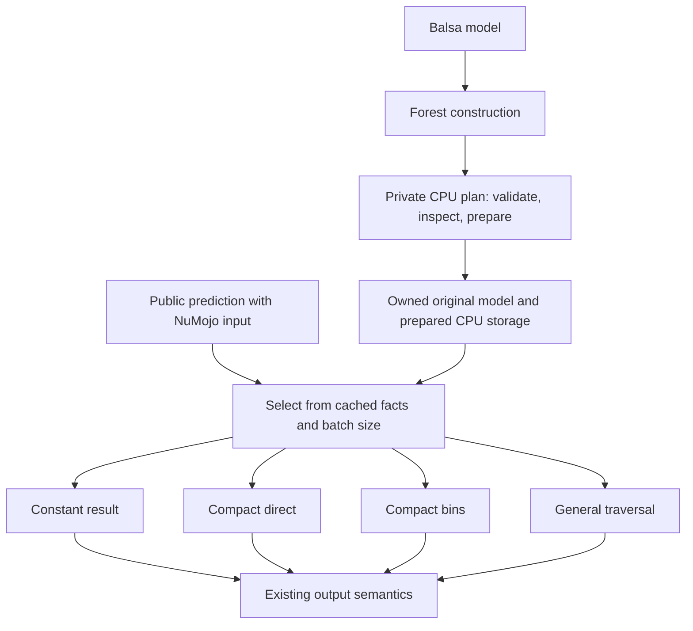

# CPU preparation behind the Forest interface

Callers continue to construct `Forest(model^)` and call `predict`,
`predict_margin`, `predict_proba`, or `predict_class` with NuMojo arrays. There
is no CatBoost flag, kernel choice, alternate Forest type, or preparation step
in the public interface.

`Forest` delegates to the private `_CPUPlan` module. The plan owns the Balsa
model, structural facts, packed arrays, constant sum when applicable, and CPU
execution. `_Symmetric` implements symmetric inspection, packing, bin preparation,
and leaf indexing. Moving or replacing CPU execution therefore does not require
changing callers or the GPU implementation.



## Selection rules

| Model/input property | Execution |
|---|---|
| Every tree consists of one leaf root | Cache the ordered sum at construction; apply averaging/base score and output transform at prediction |
| Every tree meets compact eligibility; byte bins have reuse; at least 256 rows | Symmetric evaluation with per-call feature bins |
| Every tree meets compact eligibility; bin policy is not selected | Symmetric evaluation with direct float comparisons |
| Otherwise, within supported inference semantics | General traversal over packed depth-first nodes, specialized for uniform LT or LE splits |

Compact eligibility requires finite numerical LE splits, identical feature,
threshold, operator and missing direction within each level, and uniform leaf
depth within each tree, up to 16. Different trees can use different features,
thresholds and depths. Originating framework metadata is never consulted.
An ineligible tree keeps the whole forest on general traversal. We deliberately
do not regroup trees, mix per-tree kernels, or change accumulation order.

Inspection and packing happen during construction. Predictions consult cached
facts and input dimensions, without rescanning nodes. Private strategy overrides
exist only for differential tests and benchmark controls; the plan constructor
rejects overrides that cannot evaluate the supplied model. Controls validate a strategy override without changing eligibility facts or
copying the prepared model, keeping allocation layout comparable.

Root-only trees and stumps are different cases. A root-only tree has one leaf,
no split, and a constant contribution. A stump has one split and two leaves
(three Balsa nodes); every stump may split on a different feature. Stumps are
structurally symmetric, although operator and binning eligibility still apply.

CPU execution stays pure Mojo. Input, result, packed arrays and byte scratch
remain NuMojo-owned. The original Balsa model is retained, so compact preparation
still increases resident model storage. Constant and symmetric execution remain
serial; existing general scheduling is unchanged. Concurrency redesign and GPU
changes are outside this work.

## Trainer-independent fixtures

`tests/cpu_fixtures.mojo` supplies deterministic Balsa builders and inputs shared
by tests and benchmarks. It has no CatBoost dependency. Families include:

- Leaf-only forests, both with zero features and with unused input features.
- Stumps selecting different features across trees, with and without bin reuse.
- Symmetric forests at depths 4, 8, 12 and 16.
- Full asymmetric trees at those same depths.
- Uneven chains and mixtures of leaves, stumps, full trees and chains.

Inputs use SplitMix64 to avoid a small repeating set of correlated rows, with
explicit ties, NaNs, signed zero and infinities. Correctness compares the public
interface to a separate scalar oracle over original Balsa child links. Both
dtypes, regression/classification, averaging, bias, sigmoid scale, empty batches,
and vector/tile boundaries are covered. A separate test visits all 65,536 leaf
addresses of depth-16 trees, in direct and binned modes and both dtypes, with a
partial final tile. A depth-17 fixture verifies generic fallback. Existing
operator, precision, ownership, offset-view and concurrency tests remain active.

```sh
pixi run check
pixi run benchmark-cpu-shapes-build
pixi run python tools/benchmark_cpu_shapes.py build/cpu-shape-sweep
```

The benchmark performs scalar-oracle gates before timing public allocating margin
calls. Construction, input generation and warmups are excluded; output allocation,
binning, inference, transformations and result disposal are included. Generic and
direct controls select validated private strategies outside timing. Preparation duration is
recorded separately as one diagnostic observation, excluding the source-model
copy, and is not presented as a calibrated construction benchmark.

The default sweep has 15 configurations × two dtypes × four batch sizes
(1, 32, 256, 5,000). It records selected routes and node counts, calibrates at least
50 ms per interval, and collects three measurements in each of three randomized
rounds on one pinned CPU. Outputs require a fresh directory. These are structural
performance fixtures, not trained-model accuracy or cross-framework comparisons.

Full binary-tree storage grows exponentially: depth 12 has 8,191 Balsa nodes per
tree, and depth 16 has 131,071. The sweep uses 64 depth-12 trees and four depth-16
trees for similarly sized expanded models (about 524,000 nodes), plus a four-tree
pair at depths 12 and 16. This preserves Balsa's existing one-million-node limit;
it does not silently enlarge loading limits to permit huge deep ensembles.

The [measured structural sweep](benchmarks/cpu-shapes/README.md) retains all
120 gates and 2,808 timing intervals, including depth-12/16 and degenerate cases.
